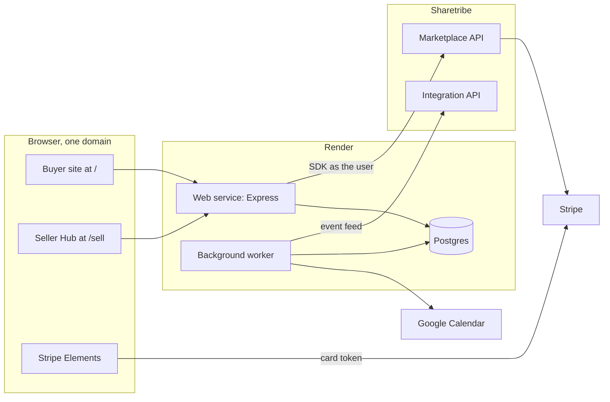

# Campus Connect on Sharetribe

The diagram and full detail are also in the [Campus Connect on Sharetribe canvas](C:\Users\katar\.cursor\projects\c-Users-katar-OneDrive-Documents-GitHub-cc-full-stack\canvases\render-hosting.canvas.tsx).

## Architecture

- **Frontend:** Campus Connect files from `Campus-Connectsd/Sellers-Based-on-Buyers` move into `web/` in this repo. Views, actions, and CSS stay. `web/shared/api.js` keeps its method names and return shapes but calls `/api/cc/*` with fetch. `mock-data.js` and the `sessionStorage` handoff are deleted.
- **Web service:** a new Express entry serves `web/` at `/` and `/sell`. It mounts the existing [server/apiRouter.js](server/apiRouter.js) at `/api` and a new `/api/cc` router. Sessions use `createCookieTokenStore` from [server/api-util/sdk.js](server/api-util/sdk.js), so one cookie covers both sites.
- **Worker:** a second Render service from the same repo. It polls Sharetribe events to issue or void ticket codes, approve verified `@sdsu.edu` users, sync calendars, write notifications, and roll up stats.
- **Postgres tables:** `tickets`, `threads`, `messages`, `board_posts`, `directory_entries`, `notifications`, `listing_events`, `seller_daily_stats`, `calendar_connections`, `support_cases`, `reports`, `blocks`, `order_flags`, `event_door_helpers`, `event_cursor`.

## Decisions made

- **Backend:** Sharetribe stays as the backend.
- **Addresses:** one domain, buyers at `/` and sellers at `/sell`.
- **Signup:** verified SDSU email only, enforced by Sharetribe approval-to-join plus worker auto-approval. Sign-in is email and password, or Google restricted to `@sdsu.edu`. No Facebook.
- **Tickets:** organizer-sold tickets with a QR code, plus wanted/for-sale posts with DMs only. A new `cc-ticket` transaction process: pay, scan to complete, reviews, refund before the event.
- **Instant book:** dropped.
- **Non-order threads:** stored in Postgres and merged into the same inbox.
- **Housing agents:** profile plus a "Visit site" external link. No store and no chat.
- **Not in v1:** chore board, review replies, paid ticket resale, manual withdraw, listing saves, push notifications, and any email beyond what Sharetribe sends.
- **Notifications:** in-app bell from Postgres, written by the worker and web service. Email comes only from Sharetribe.
- **Seller analytics:** built in-house. Sharetribe supplies orders, earnings, ratings, and inquiry counts; Postgres supplies views and traffic sources.
- **Team analytics:** Google Analytics 4, set up to comply with privacy law (see phase 7b).
- **Fees:** 3.6% with a $0.30 minimum, taken from the seller's payout (Sharetribe provider commission). Buyers pay the listed price.
- **Who sells:** SDSU students only. No outside businesses. Clubs and orgs sell through a member's account.
- **Premium:** hidden in v1.
- **Door scanning:** the event's seller plus door helpers they add.

## Flows checked against the prototype

Every buyer and Seller Hub screen in the prototype was compared with Sharetribe's default processes and this plan. Each item below says how it is handled.

### Orders that don't match Sharetribe's default processes

- **Seller cancel and complete:** in `default-booking` and `default-purchase`, only the operator can cancel after payment or complete a session early. The prototype's "Cancel & refund" and "Mark session completed" buttons call `/api/cc`. The web service checks that the caller is the listing's seller and that the order is in an allowed state, then runs the operator transition (`transition/cancel`, `transition/operator-complete`) through the Integration API. The web service gets Integration API credentials too, not only the worker. No process changes.
- **Reschedule:** `default-booking` has no reschedule transition. Remove the button. The seller messages the buyer, cancels, and the buyer rebooks.
- **Product accept and decline:** `default-purchase` has no accept step; a paid order is confirmed. Remove accept and decline for products. "Ready for pickup" sends a bell notification and an automatic order message, and is stored as a flag in Postgres (`order_flags`), not a transition. "Mark picked up" runs `transition/mark-delivered`.
- **"Got it" and "Report a problem" buttons:** new buttons on the buyer's order detail in `web/buyer/views.js`, with matching `api.js` calls (`confirmOrderReceived`, `reportOrderProblem`). The prototype has neither.
  - **Products:** "Got it" shows as soon as the order is paid, so a buyer can confirm a pickup even if the seller forgot to mark it. It runs `transition/mark-received-from-purchased` before the seller marks it picked up and `transition/mark-received` after; either one releases the payout and opens reviews. "Report a problem" shows once the seller marks it picked up (the process only allows a dispute from that state). It asks for a reason (didn't get it, not as described, other) and a short note, runs `transition/dispute`, posts the note as an order message, and writes a `reports` row linked to the order. If the buyer does nothing, the process marks it received on its own timer.
  - **Services and tickets:** "Report a problem" shows after the session or event and writes the same `reports` row. There is no dispute transition in these processes, so the payout isn't held. "Got it" doesn't apply; a session completes on its own and a ticket completes when scanned.
  - **Resolving:** disputed orders and order reports appear at the top of the `/admin` queue. The team settles a product dispute in Console with the operator transitions (`transition/mark-received-from-disputed` pays the seller, `transition/cancel-from-disputed` refunds the buyer). If nobody acts, the process refunds the buyer on its own timer, so the queue must be checked daily. The seller gets a bell notification when a dispute opens and when it's settled.
- **Pickup only:** product listings use pickup as the only delivery method. No shipping.
- **Request a review:** Sharetribe already sends review reminders. Remove the seller's "Request review" button.
- **Buyer cancellation:** default processes don't let buyers cancel. The order page says to message the seller, and disputes go to the team.
- **Message a store with no listing:** Sharetribe threads must belong to a listing, so "Message store" and "Message seller" from a profile open a Postgres thread.
- **Delete listing:** Sharetribe can't delete a published listing. "Delete" closes it and hides it from the Seller Hub. Drafts are discarded for real. "Duplicate" re-uploads the images.

### Tickets

- **Only events the seller runs:** a ticket listing is for an event the seller or their org hosts and scans. The listing form asks them to confirm that. Tickets to outside events (stadium games, venue concerts) go in ticket posts. The prototype's "Aztecs vs. Boise State" and "Open Air concert" listings become posts in the seed data.
- **`cc-ticket` spec must include:** an inquiry transition for questions before buying, sales closing at event start, seller and operator cancel with full refund before the event, automatic completion a few hours after the event so unscanned tickets still pay out, and reviews.
- **Door helpers:** an `event_door_helpers` table (listing id, helper user id). The seller adds helpers by SDSU email. `scanTicket` accepts the seller or a helper. Helpers only see the scan screen for that event.
- **No double entry:** marking a code used is a single conditional update (`WHERE status = 'issued'`), so two doors scanning the same code at once can't both succeed. Manual code entry stays as the fallback when the camera fails.
- **Account deletion:** add the `cc-ticket` payment states to [server/api/delete-account.js](server/api/delete-account.js), as [src/transactions/README.md](src/transactions/README.md) requires for any new process with payments.

### Money

- **Commission:** 3.6% of the order, with a minimum of $0.30, taken from the seller's payout. Set both in Console under Commission (`providerCommission.percentage` = 3.6, `minimum_amount` = 30 cents). [server/api-util/lineItemHelpers.js](server/api-util/lineItemHelpers.js) already uses the minimum when 3.6% comes to less than $0.30, which is any order under $8.34.
- **Commission doesn't cover Stripe yet:** Stripe's card fee (about 2.9% plus 30 cents) is paid out of the commission. At 3.6% the margin is 0.7% minus 30 cents, so every order under about $43 costs the platform money: a $5 sale earns $0.30 and pays about $0.45, a $20 sale earns $0.72 and pays about $0.88. Stripe Connect also charges per active seller per month and per payout. Accepted for launch; revisit after a month of real orders.
- **Minimum price:** set Console's minimum listing price to $1.00. The line item code throws an error when the minimum commission is more than the order total, and Stripe won't charge under $0.50.
- **Where fees show:** remove the "Platform fee $0.00" line from buyer checkout. The seller's order detail and Payouts page show the commission and net amount.
- **Payout timing:** the Seller Hub says when money arrives: after the pickup is received, the session ends, or the event completes.
- **Refunds:** default processes only refund in full. No partial refunds in v1.
- **Taxes:** turn on Stripe Connect 1099 reporting before any seller crosses the IRS threshold. California marketplace sales tax collection starts above $500,000 a year in sales; revisit then.

### Accounts and people

- **Students only:** drop College Cubbies and other non-student sellers from the seed data.
- **Graduates:** accounts stay active after graduation. Revisit if that becomes a problem.
- **Age:** the terms require users to be 18 or older. Stripe enforces it for sellers during payout setup.
- **Profile visibility:** the prototype's "profile visible" and "show campus" settings live in profile data; a hidden profile returns "not found" to others.
- **Removed from the UI:** Premium banners, modal, and toggle; chore board links from Book, Sell, and Home; the instant-book setting; the agent message button.

### Safety and moderation

- **Report and block:** report buttons on listings, profiles, posts, and messages write to `reports`. Block writes to `blocks`; the web service hides the blocked person's messages, listings, and posts from the blocker and stops new threads between them.
- **Admin page:** `/admin` in the web service, for users with `metadata.isAdmin` (only settable in Console, so users can't grant it to themselves). Review reports, hide board posts and threads, edit school services, apartments, and agents, and read support cases. Sharetribe Console stays the tool for users, listings, and orders.
- **Rules pages:** Terms, Privacy, and Community guidelines at `/terms`, `/privacy`, and `/guidelines`. Guidelines cover prohibited items, the ticket rule above, fair-housing wording and landlord permission for subleases, no upfront payments on jobs, and meeting in public for pickups.

### Search and browse

- **Search:** listings come from Sharetribe search: keywords, category, kind, and price.
- **Remove the seller filter:** delete the "4.8+ rating" and "Student verified" options. With both gone, the whole "Any seller" dropdown (`TRUST_OPTIONS` and the `state.trust` check in `web/buyer/views.js`) is removed.
- **Ratings still show, and "Top rated" sort stays:** Sharetribe can't sort by reviews, so the worker writes each listing's and seller's average rating and review count into public data on every review. Cards, store pages, and the "Top rated" sort read those fields.

### Links and sharing

- **Shareable paths:** share links use real paths (`/listing/<id>`, `/store/<id>`, `/event/<id>`). Express returns the buyer page with Open Graph tags (title, photo, price) filled in for that item, so links preview in iMessage and Instagram, then the app opens that screen. Hash URLs can't produce previews.

### Reliability

- **Expired sessions:** `api.js` treats a 401 as signed out, shows sign-in, and returns to the same screen afterward.
- **Time zone:** availability, event times, and daily rollups all use America/Los_Angeles.
- **Worker safety:** the worker keeps its place in Sharetribe's event feed in `event_cursor`, and every handler is safe to run twice (for example, ticket codes are unique per transaction and seat).
- **Checkout edge cases:** checkout handles Stripe's 3D Secure step and Sharetribe's 15-minute payment expiry, and tells the buyer to try again.
- **Seed data:** replace demo people and listings with real school services, apartments, and agents; keep the photos that apply.

## Phases

0. **Setup.** Write the `cc-ticket` spec under [ext/transaction-processes](ext/transaction-processes) (contents listed under Tickets above) and push it with the Sharetribe CLI. Create three listing types in Console: product with pickup only, service, and event ticket. Set the provider commission to 3.6% with a $0.30 minimum, and the minimum listing price to $1.00. Create an Integration API app. Bring Campus Connect into `web/` with git subtree. Get approval for `pg`, `sharetribe-flex-integration-sdk`, and a Google Calendar client.
1. **Serve and sign in.** Add the Express entry and the `/api/cc` router. Rewrite `api.js` as fetch calls. `switch-mode` navigates between `/` and `/sell`. Sign-out clears the one Sharetribe cookie shared by both sites.
   - **SDSU-only that can't be bypassed:** turn on "require approval to join" in Console access control. Sharetribe's sign-up API accepts any request with the marketplace client ID, which is visible in the cookie name, so the endpoint check alone is not enough. The `/api/cc` signup rejects non-`@sdsu.edu` emails early. The worker approves a pending user through the Integration API only once their email is verified and ends in `@sdsu.edu`.
   - **Email changes:** `/api/cc` rejects changing to a non-SDSU email. If the worker sees an approved user whose email is no longer `@sdsu.edu`, it removes their permission to post listings and start orders.
   - **Fixed link paths:** Sharetribe's built-in emails link to `/verify-email?t=…` and `/reset-password?t=…&e=…`. Express serves screens at those exact paths. They call Sharetribe through `/api/cc`, then go to `/`. These tokens are scrubbed from Google Analytics (phase 7b).
   - **Google sign-in, SDSU only:** keep [server/api/auth/google.js](server/api/auth/google.js) and [server/api/auth/createUserWithIdp.js](server/api/auth/createUserWithIdp.js). In `verifyCallback`, accept only when `email_verified` is true and the email ends in `@sdsu.edu`; otherwise return the user to sign-in with an error. SDSU email is on Microsoft 365, so students use a personal Google account registered with their `@sdsu.edu` address. Do not send the `hd` hosted-domain parameter: it only matches Google Workspace domains and would hide those accounts. Replace the deprecated `plus.login` scope with `openid email profile`. Remove the Facebook routes from [server/apiRouter.js](server/apiRouter.js). The sign-in screen tells students to use the Google account set up with their SDSU email. Email and password remain the main path.
   - **New screens in `web/`:** sign up (name, SDSU email, password, terms and privacy checkbox), sign in, Continue with Google, a Google confirm step for first-time users (name and terms), forgot password, check-your-inbox, verify email, reset password, and a short "finishing setup" state while the worker approves.
   - **Pending users:** until approved, the buyer site can browse but buy, message, and sell actions show "Finish verifying your SDSU email." The Seller Hub shows the same message.
   - **Terms:** signup stores the accepted terms version and time in the user's private data.
   - **Becoming a seller:** every approved user can sell. Publishing the first paid listing requires Stripe payout setup (phase 3), so the Seller Hub shows "Set up payouts" first. Stripe does the identity and age checks.
   - **Smaller pieces:** the backup phone number goes in protected profile data. The "Student verified" badge reflects the verified `@sdsu.edu` email. Add rate limiting to the signup, login, and reset endpoints.
2. **Listings and stores.** Write a server mapper between Sharetribe listings and the Campus Connect listing shape. Implement listing create, update, duplicate, and delete. Upload images with `sdk.images.upload`. Store data goes in user `publicData`. Away mode closes and reopens the seller's listings.
3. **Checkout and orders.** Replace the card form in `buyer/views.js` with Stripe Elements. `placeOrder` goes through `/api/initiate-privileged` and `/api/transaction-line-items`. Seller order buttons become transitions. Reviews use review transitions. Payouts show Stripe Connect onboarding and a read-only status.
4. **Tickets.** The worker issues one code per seat after payment. The buyer's order shows the QR, drawn by `shared/qr.js`. `scanTicket` checks that the seller owns the listing, marks the code used, then runs the completing transition. Refund or cancel voids unused codes.
5. **Messaging and notifications.** Listing questions use a Sharetribe inquiry; order threads use `sdk.messages`. Job, housing, and ticket-post threads go in Postgres. `getConversations` merges both. `api.subscribe` polls `/api/cc/changes`.
   - **In-app bell:** the worker turns Sharetribe events (new order, accepted, canceled, completed, ticket sold or scanned, new message, new review) into `notifications` rows for the right person. The web service writes a row when a Postgres post-thread message is saved. The bell polls through `/api/cc/changes`.
   - **Email:** only what Sharetribe already sends. That means the process templates (including the new `cc-ticket` templates), the built-in new-message email for order and inquiry threads, and verification and password reset. No email service of our own, and no email for job, housing, or ticket-post messages.
   - **Settings:** keep the Messages, Orders, Requests, and Reviews toggles. They control the bell only. The settings copy says order and message emails always come from Campus Connect, and replaces the prototype's "Nothing is emailed." Remove the Housing alerts, Payouts, and Weekly summary toggles.
   - **Not in v1:** push notifications, our own email sender, housing alerts, payout notices, and the weekly summary.
6. **Boards and directories.** Jobs, housing, and ticket posts are owned by a Sharetribe user id. School services, apartments, and agents are curated through a seed script. Reports and support requests are stored in Postgres and emailed to the team.
7. **Hours, calendar, analytics.** Weekly hours become the availability plan for each service listing. Google busy times become availability exceptions.
   - **View tracking:** `POST /api/cc/track` records one listing view per viewer per listing per day in `listing_events`, along with the source (`document.referrer` or a `?src=` tag). It skips the seller's own views and obvious bots. Store a daily-rotating hash of the viewer, not their user id.
   - **Nightly rollup:** the worker combines those events with Sharetribe completed sales (orders, earnings), reviews (ratings), and inquiry plus Postgres thread counts (messages) into `seller_daily_stats`. `getAnalytics` and `getListingStats` read only that table.
   - **Remove saves:** drop saves from the listing editor stats, the top-listings table, and the funnel in `web/seller/views.js`. The funnel becomes views, messages, orders, using real counts instead of the hardcoded `views * 0.11` and `views * 0.045`. Remove the "Demo data." label.
7b. **Team analytics and privacy.** Google Analytics 4 on `index.html` and `seller.html`, set up for California (CCPA/CPRA) and for EU or UK visitors:
   - **Consent:** load gtag with Consent Mode v2. Ad consent (`ad_storage`, `ad_user_data`, `ad_personalization`) defaults to denied everywhere. `analytics_storage` defaults to denied in the EEA, UK, and Switzerland until the visitor accepts, and granted elsewhere until they opt out.
   - **GA settings:** turn off Google signals and ads personalization, set data retention to 2 months, and do not link Google Ads.
   - **Opt-out:** add a "Privacy choices" link in the footer and settings that turns analytics off and remembers the choice. Treat a Global Privacy Control signal (`navigator.globalPrivacyControl`) as an opt-out.
   - **No personal data to Google:** send `page_view` from the hash route manually with a clean path (e.g. `/listing/:id`). Strip query strings and tokens, which covers password reset and email verification links. Never send names, emails, message text, or Sharetribe user ids.
   - **Seller analytics are separate:** `/api/cc/track` stores no IP address or user agent, only the hashed viewer and the source. Events older than 13 months are deleted, after the rollup has kept the totals.
   - **Account deletion:** extend [server/api/delete-account.js](server/api/delete-account.js) to also delete that user's Postgres rows (threads, messages, board posts, notifications, events, calendar tokens).
   - **Policy:** update the privacy policy to name GA4, the in-house view tracking, retention periods, and how to opt out or delete an account. Have a lawyer review it before launch, especially if SDSU becomes an official partner, since student-records rules could then apply.
8. **Launch.** Take the React `src/` app out of the deploy. Add `render.yaml` with the web service, worker, and Postgres. Wire up Sentry. Test with a Sharetribe test environment and Stripe test mode before switching keys.

## Still open

- Whether to raise the commission later, since 3.6% loses money on orders under about $43 (see Money).

- Later option: "Sign in with Microsoft" restricted to SDSU's Microsoft 365 tenant would match the account every student already has. This repo can already act as the OpenID Connect proxy Sharetribe needs (`/.well-known` routes, [server/api-util/idToken.js](server/api-util/idToken.js)).

- Hash-routed pages are not indexed by search engines. That only matters if listings should be public and findable.
